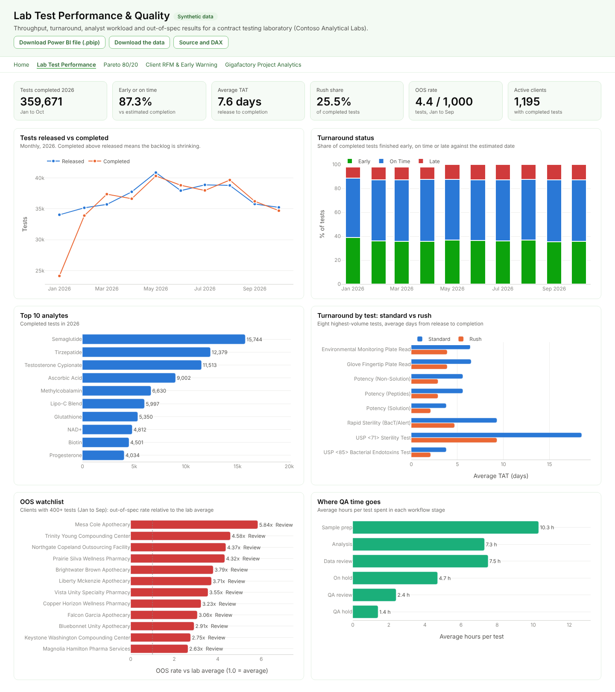

# Lab Test Performance & Quality Dashboard

Operational dashboard for a contract testing laboratory: test throughput, turnaround time (TAT), rush work, analyst productivity, QA approval workload, and out-of-specification (OOS) results. 14 report pages, 116 DAX measures.

> Data is synthetic (fictional "Contoso Analytical Labs"), generated by [`generate_lab_data.py`](../data-generator/generate_lab_data.py): ~371,000 completed tests in 2026, ~370,000 released tests, ~267,000 QA review records and ~1,400 OOS events.

**[Open the interactive dashboard](https://snehaajmira.github.io/powerbi-analytics-portfolio/lab-test-performance.html)** · **[Download Power BI file (.zip)](https://snehaajmira.github.io/powerbi-analytics-portfolio/downloads/01-lab-test-performance-powerbi.zip)** · **[Data download](https://github.com/SnehaAjmira/powerbi-analytics-portfolio/releases/tag/lab-data-v1.0)**

## Business questions

- Are we completing tests faster than they are released, or is the backlog growing?
- What share of tests finish early, on time or late, and does rush work hurt TAT?
- Which clients, analytes and tests drive volume and late results?
- How does each analyst trend month over month against the lab average?
- Where does time go between sample prep, analysis, data review and QA?
- Which clients and analytes have OOS rates well above the lab rate, and should they be kept, watched or reviewed?

## Pages

KPI, Trends, Test Activity, Tests Released vs Completed, Analyte Released vs Completed, Top N Analytes, TAT Trend, TAT Dispersion Analysis, Rush Activity, Analyst Performance, Approvals, OOS, OOS 2, NCR.

## Notable DAX

| Measure | Technique |
|---|---|
| `Released Not Completed` | `EXCEPT` between two `VALUES` tables to find submissions released but not yet completed |
| `New Clients` / `Lost Clients` | Client churn using `PREVIOUSMONTH` inside a `FILTER` over client values |
| `Analyst Growth Label` | Month-over-month variance compared with the `AVERAGEX(ALLSELECTED())` lab average, banded into Growing / Stable / Below Average |
| `OOS Client Index`, `Past Due Index` | Client or analyte rate divided by the lab rate (`REMOVEFILTERS` on client and analyte) |
| `Keep Review Flag` | Combines the two indexes with a volume floor into Keep / Watch / Review / Low Volume |
| `r Tests Completed vs OOS Client Rate` | Pearson correlation written in DAX with `ADDCOLUMNS` and `SUMX` |
| `*MoM Label` / `*Colour` | Arrow labels and hex colors for conditional formatting |

Full code: [dax/measures.dax](dax/measures.dax), [dax/calculated_tables_and_columns.dax](dax/calculated_tables_and_columns.dax), [powerquery/queries.m](powerquery/queries.m).

## Model

Fact tables: `Tests Complete`, `Tests Release`, `Quality Data`, `OosByClient`, `OosByTechnician`. Dimensions are DAX calculated tables built with `DISTINCT(UNION(...))` across both test facts (client, analyst, analyte, test, rush) plus a `DimCalender` date table and a `Departments` lookup.

## Open it in Power BI Desktop

The `pbip/` folder is a Power BI Project: the full report and model saved as text files, so they can be tracked on GitHub. A `.pbip` file only opens together with its `.Report` and `.SemanticModel` folders, so download the **[ready-made zip](https://snehaajmira.github.io/powerbi-analytics-portfolio/downloads/01-lab-test-performance-powerbi.zip)** and unzip it rather than downloading single files.

1. Download the data from the [lab-data-v1.0 release](https://github.com/SnehaAjmira/powerbi-analytics-portfolio/releases/tag/lab-data-v1.0) and unzip it into `C:\PowerBI\` (it creates the `lab` folder).
2. Open `pbip/Lab Test Performance.pbip` in Power BI Desktop (Windows, a recent version).
3. If your folder is different, go to **Transform data > Edit parameters** and change `DataFolder`.
4. Click **Refresh**. The model loads the synthetic data and every visual fills in.
5. To get a single .pbix file: **File > Save as**, choose *Power BI file (.pbix)*.
