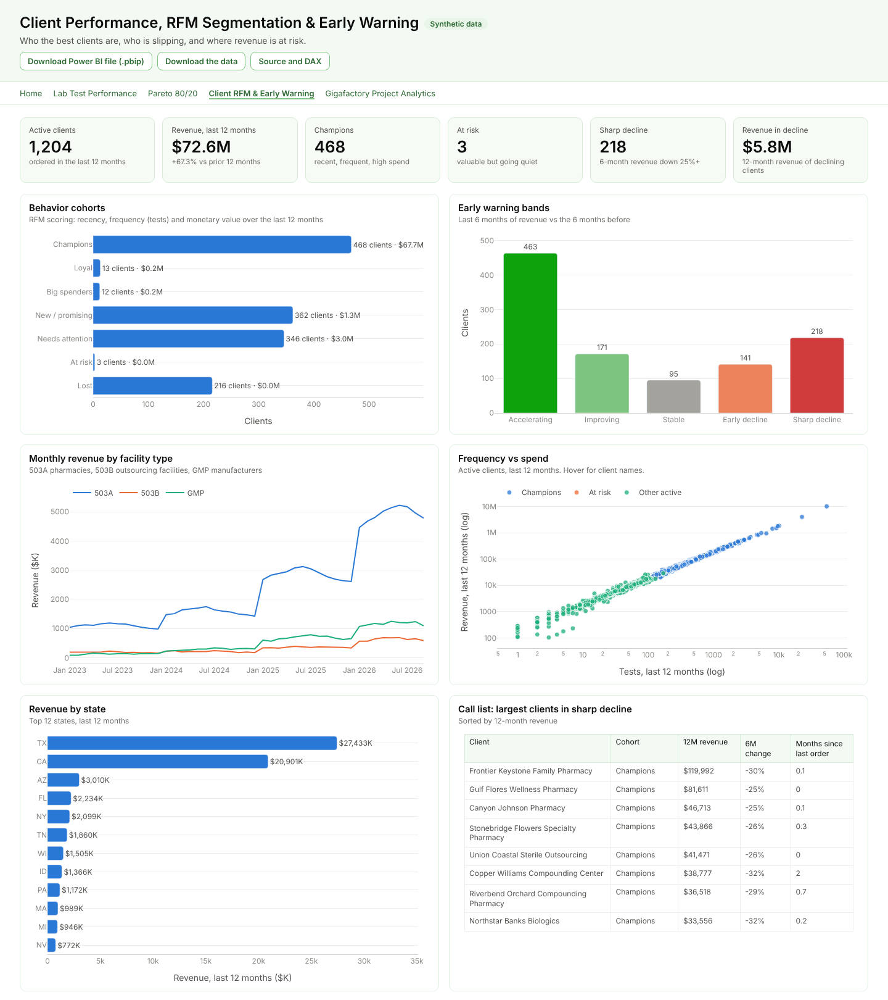

# Client Performance, RFM Segmentation & Early Warning

Commercial dashboard combining lab services, product sales (environmental monitoring plates and swab kits) and consulting revenue per client. It scores every client on Recency, Frequency and Monetary value, places them in behavior cohorts, and flags clients whose revenue is falling before they churn. 10 pages, 77 DAX measures.

> Data is synthetic (fictional "Contoso Analytical Labs"): ~860,000 service records, ~1,870 product orders and ~645 consulting activities for ~1,500 US client facilities plus a Canadian site, generated by [`generate_lab_data.py`](../data-generator/generate_lab_data.py).

**[Open the interactive dashboard](https://snehaajmira.github.io/powerbi-analytics-portfolio/client-rfm.html)** · **[Download Power BI file (.zip)](https://snehaajmira.github.io/powerbi-analytics-portfolio/downloads/03-client-segmentation-rfm-powerbi.zip)** · **[Data download](https://github.com/SnehaAjmira/powerbi-analytics-portfolio/releases/tag/lab-data-v1.0)**

## Pages

Client KPI's, Client Details, Client Segmentation, Monthly Client Performance, QoQ, YOY Service Trend (Running 12M), All Trends, Services Trend, Cohorting for Plates and Swabs, Tests Tooltip.

## Segmentation logic

| Score | Rule |
|---|---|
| R (recency) | Months since last submission: 5 = within 1 month, down to 1 = over 12 months |
| F (frequency) | Tests in the last 12 months, ranked across clients into quintiles (5 = top 20%) |
| M (monetary) | Revenue in the last 12 months, ranked into quintiles |

`Behavior Cohort Advanced` combines the three scores with the revenue trend (last 12 months vs the 12 months before) into 17 cohorts, from "Champions (Growing)" and "Loyal High Frequency" to "At Risk Loyal", "Churn Risk", "Lost High Value" and "Dormant".

`Early Warning Band` compares the last 6 months of revenue with the 6 months before and labels each client Accelerating, Improving, Stable, Early Decline or Sharp Decline.

Year-over-year labels (`YoY Recency Label`, `YoY Frequency Label`, `YoY Monetary Label`) recompute the same scores as of the same date last year, with matching color measures.

## What-if scenarios

`Volume Change`, `Price Change` and `ScenarioMultiplier` are `GENERATESERIES` parameters used to model revenue under price and volume changes.

Full code: [dax/measures.dax](dax/measures.dax), [dax/calculated_tables_and_columns.dax](dax/calculated_tables_and_columns.dax), [powerquery/queries.m](powerquery/queries.m).

## Open it in Power BI Desktop

The `pbip/` folder is a Power BI Project: the full report and model saved as text files, so they can be tracked on GitHub. A `.pbip` file only opens together with its `.Report` and `.SemanticModel` folders, so download the **[ready-made zip](https://snehaajmira.github.io/powerbi-analytics-portfolio/downloads/03-client-segmentation-rfm-powerbi.zip)** and unzip it rather than downloading single files.

1. Download the data from the [lab-data-v1.0 release](https://github.com/SnehaAjmira/powerbi-analytics-portfolio/releases/tag/lab-data-v1.0) and unzip it into `C:\PowerBI\` (it creates the `lab` folder).
2. Open `pbip/Client Segmentation RFM.pbip` in Power BI Desktop (Windows, a recent version).
3. If your folder is different, go to **Transform data > Edit parameters** and change `DataFolder`.
4. Click **Refresh**. The model loads the synthetic data and every visual fills in.
5. To get a single .pbix file: **File > Save as**, choose *Power BI file (.pbix)*.
