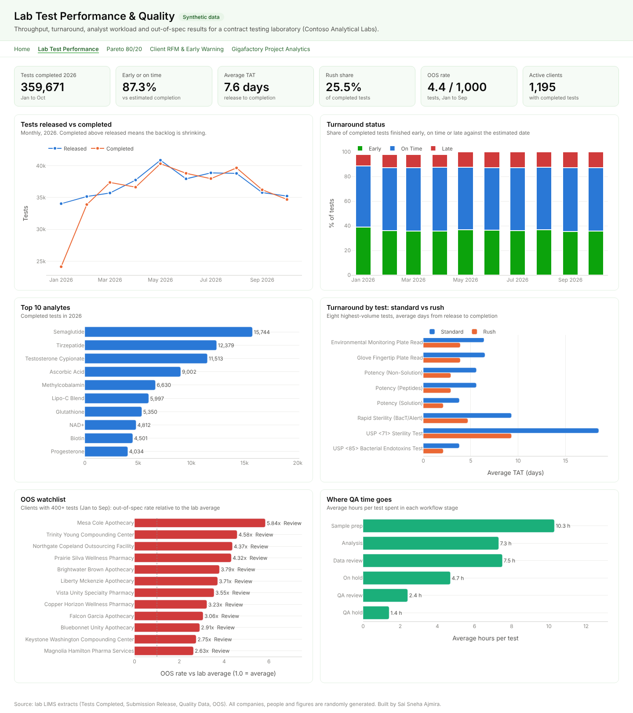
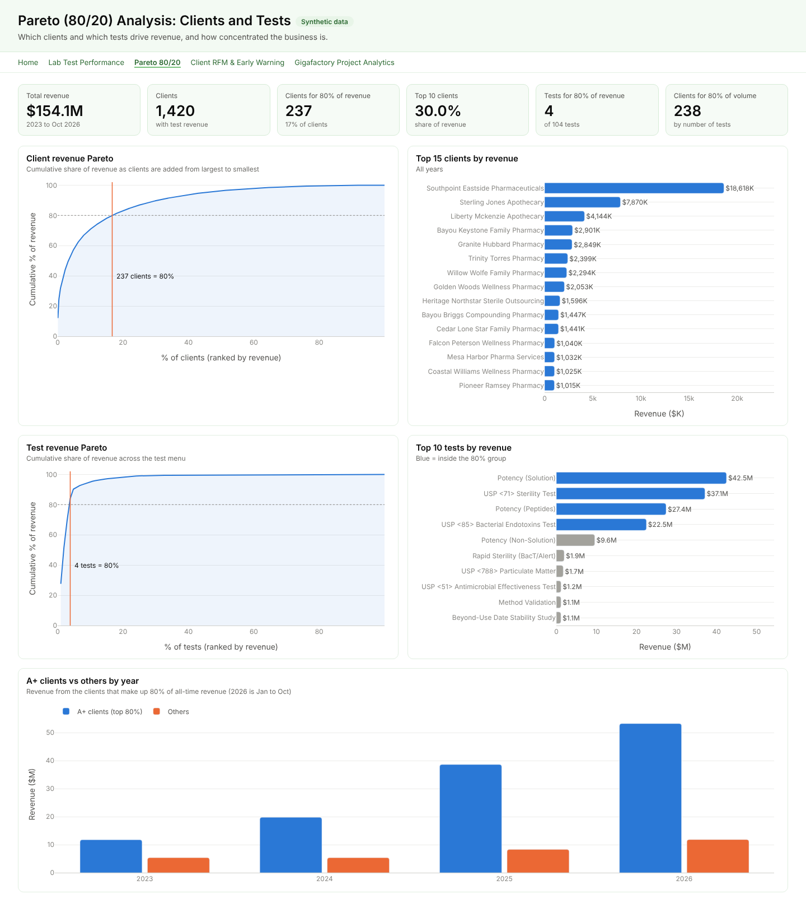
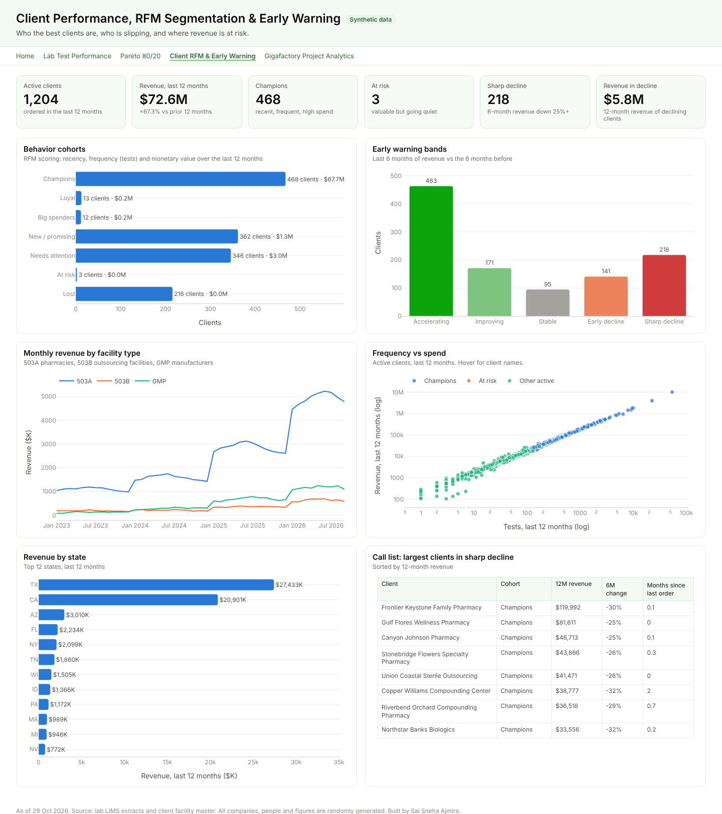
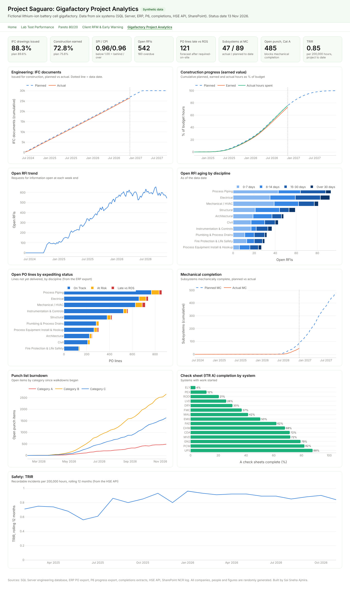

# Power BI & Data Analytics Portfolio: Sai Sneha Ajmira

Business Systems Analyst and Product Owner with a background in regulated laboratory systems (LIMS/QMS, 21 CFR Part 11, GAMP 5, ALCOA+). This repository shows Power BI data models, DAX, Power Query and Python I have built for operational, commercial, quality and project-controls reporting.

**All data in this repository is synthetic.** The lab reports were originally built on production data. For this portfolio they were re-pointed to generated data for a fictional company ("Contoso"), and every client, analyst, product, ID and figure is randomly generated. No employer data, client names or confidential information is included.

[LinkedIn](https://www.linkedin.com/in/contactsnehaajmira) · **[Live interactive dashboards](https://snehaajmira.github.io/powerbi-analytics-portfolio/)**

## Projects

| # | Project | Domain | Highlights |
|---|---|---|---|
| 01 | [Lab Test Performance & Quality](01-lab-test-performance/) | Laboratory operations / QA | TAT early-on-time-late analysis, released vs completed backlog, analyst MoM benchmarking, OOS rate indexes with Keep / Watch / Review flags, Pearson correlation in DAX. 116 measures. |
| 02 | [Pareto 80/20 Analysis](02-pareto-80-20-analysis/) | Commercial analytics | Dynamic Pareto cut-off parameter, `WINDOW`-based running totals, A+ vs Others split for clients and tests. |
| 03 | [Client RFM Segmentation & Early Warning](03-client-segmentation-rfm/) | Customer analytics | RFM scoring, 17 behavior cohorts, 6-month revenue early-warning bands, YoY comparisons, what-if price and volume scenarios. |
| 04 | [Multi-Source Gigafactory Project Analytics](04-gigafactory-project-analytics/) | Construction / capital projects | Battery cell gigafactory project with data in six systems (SQL Server, ERP, P6, completions CSV folder, JSON API, SharePoint). T-SQL views and analysis queries, Power Query integration with a vendor cross-reference, earned value, IFC curves, ITR / punch / turnover, TRIR, plus a Python cross-source data quality and KPI script. ~790k rows. |

## Dashboards

| | |
|---|---|
| [](https://snehaajmira.github.io/powerbi-analytics-portfolio/lab-test-performance.html) | [](https://snehaajmira.github.io/powerbi-analytics-portfolio/pareto-80-20.html) |
| [](https://snehaajmira.github.io/powerbi-analytics-portfolio/client-rfm.html) | [](https://snehaajmira.github.io/powerbi-analytics-portfolio/gigafactory-project-analytics.html) |

Each project folder also has a `pbip/` Power BI Project (report + model) connected to the synthetic data through a folder parameter. Open it in Power BI Desktop, refresh, and save as .pbix if you want a single file.

## Repository layout

```
├── 01-lab-test-performance/       README, DAX, Power Query, report (.pbip), screenshots
├── 02-pareto-80-20-analysis/
├── 03-client-segmentation-rfm/
├── 04-gigafactory-project-analytics/  README, SQL, Power Query, DAX, model design, Python analysis
├── data-generator/                Python scripts that create all synthetic data
├── data/sample/                   Small samples of every table (full data in Releases)
├── dashboards/                    Python that builds the interactive HTML dashboards and screenshots
├── powerbi/                       Python that writes the Power BI Project (.pbip) files
├── docs/                          GitHub Pages site (interactive dashboards)
├── assets/                        Shared report background
└── docs/repoint-guide.md          How the original reports were moved to synthetic data
```

## Reproduce the data

```bash
cd data-generator
pip install -r requirements.txt
python generate_lab_data.py --out ../data/lab            # ~860k test records, Excel files (~4 min)
python generate_gigafactory_data.py --out ../data/gigafactory   # six source systems, ~790k rows (~30 s)
```

Use `--scale 0.1` for a quick 10% sample. Both generators use a fixed random seed, so the output is the same every run. The full datasets are too large for the repository, so they are attached to two releases: [lab-data-v1.0](https://github.com/SnehaAjmira/powerbi-analytics-portfolio/releases/tag/lab-data-v1.0) (projects 01 to 03) and [gigafactory-data-v1.0](https://github.com/SnehaAjmira/powerbi-analytics-portfolio/releases/tag/gigafactory-data-v1.0) (project 04).

## Tools

Power BI Desktop (DAX, Power Query M, PBIP), SQL Server (T-SQL), Python (pandas, NumPy, Faker, XlsxWriter), Git / GitHub.
